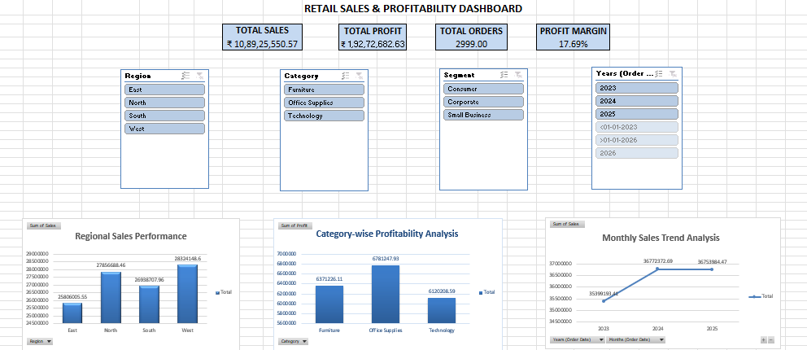

# Retail Sales and Profitability Analysis

## Project Overview
This project focuses on analyzing retail sales and profitability using Microsoft Excel. It aims to understand sales performance, revenue patterns and profitability through data analysis.

## Tools Used
- Microsoft Excel
- Excel Formulas
- Pivot Tables
- Data Cleaning
- Charts and Visualization

## Project Objectives
- Analyze retail sales performance.
- Understand revenue and profitability.
- Identify sales trends and patterns.
- Present insights through Excel analysis.

## Project File
- Retail_Sales_Profitability_Analysis.xlsx

## Key Skills
Microsoft Excel | Data Analysis | Data Cleaning | Pivot Tables | Data Visualization

## Dashboard Preview

## Pivot Table Analysis

---
**Created by Shalini**
